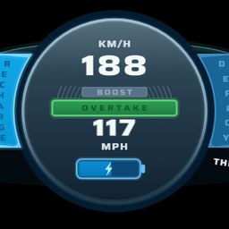
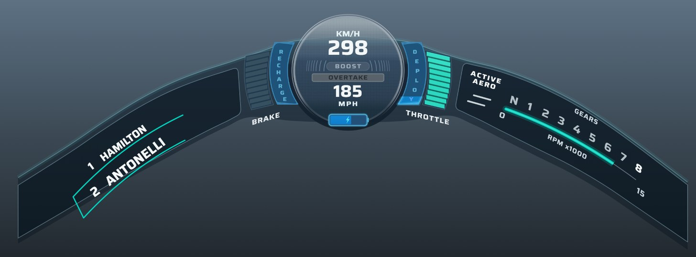
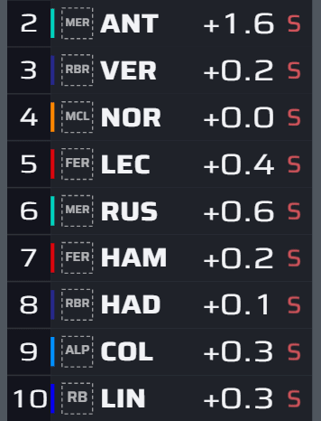
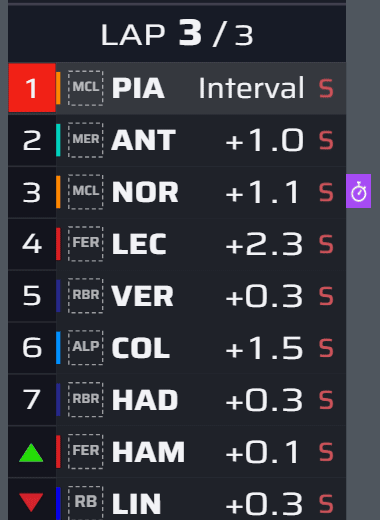

# Project Halo — F1 25 addon (Swofty) — beta

Project Halo puts the onboard halo graphic from the 2026 F1 world feed in place of the dial of F1 25's 2026, 2025 and F2 cars, an animated, broadcast-style timing tower in place of the Track Position list, and the pit lane timer and the lap times as broadcast cards. The game's own HUD draws all of them, so you move and resize them in HUD customisation like any other element, and they hide when the game hides its HUD.

Project Halo reads the running game itself and changes nothing in it: no UDP telemetry, no companion app, and the game's telemetry settings make no difference.

**Download:** install it from the Addon Browser in the Swofty Launcher, or get the zip from [Releases](https://github.com/nyannoying1337/f1-25-project-halo/releases) and import it.

*Preview renders. In the game, the texts use the game's own font, and the game's team logos replace the small team labels.*

## What you get

- **The halo:** your speed in km/h and mph, the battery, and the Boost and Overtake lights in the centre, between the Recharge and Deploy bars. Throttle and brake bars on either side. Gear, revs and Active Aero on the right wing. Your position and name, the car one place ahead in the classification, and the next turn's number and direction on the left wing.
- **Two halo layouts:** Default camera sits on the car's own halo as the default T-cam shows it, even-sided and larger. TV offset is the broadcast's off-centre halo at the bottom of the screen.
- **Halo animations:** a bright streak runs out along both wings when Boost or Overtake comes on, the gear number ticks on every shift, the RPM line turns white near the limiter, the name of the car ahead rolls over when it changes, and the active aero bars turn between their two shapes.
- **2025 and F2 cars:** the same halo with DRS. 2025 cars also show the ERS deploy mode (NONE, MEDIUM, HOTLAP, OVERTAKE), the battery and Recharge and Deploy. F2 cars have no energy parts.
- **Timing tower:** positions, team logos and colours, driver codes, intervals or gaps to the leader, tyres, PIT, Out, DSQ and NC, and a green or red arrow when a car gains or loses a place. Its header shows the lap or the session, and the safety car, virtual safety car, yellow flag, red flag and chequered flag. Practice, qualifying, races, Time Trial, replays, the highlights reel and the spectator view, with up to 30 cars.
- **Tower animations:** when cars change places, their rows slide into their new positions, fast at first and then settling, like the broadcast. The position arrow rides in with its row, and the position number and a new best lap time fade in. Flag cards (yellow flag, VSC, safety car, red flag, chequered flag) slide down out of the header and the rows move down with them; when the flag ends, the card rolls back up and the rows close the gap. The Animations setting switches them off.
- **Lap times in practice and qualifying:** the leader's best lap and every other car's gap to it. A new personal best flashes green for 2 seconds, a new session best purple. The header shows the session's clock, and in Q1 and Q2 (SQ1 and SQ2 in sprint qualifying) a red hatch marks the cars in the knockout zone.
- **Fastest lap in races:** a purple stopwatch beside the car with the fastest lap.
- **Pit lane timer:** position, team logo, surname, team colour line, IN PIT with the pit lane time, and the stop time under it.
- **Lap time card:** position, team logo, surname and tyre, the running lap time, and S1, S2 and S3 as bars that grow in white and take the game's sector colour. The lap time turns green on a personal best and purple on the session's fastest lap. Best and Previous sit below.
- **Race Control banner:** the game's own race messages, in the style of the broadcast's Race Control banner. At pit entry the whole message is red while you are over the pit limit and green once you are under it.
- **Spectator view:** the halo shows the car you watch, and the tower replaces the spectator board with that car highlighted. The tower follows the Spectator Menu's Gap and Detail options.
- **G-force meter (optional):** the 2026 broadcast's G-force meter in the middle of the halo.

## How to start

1. Enable **Project Halo** in the launcher and start the game.
2. Open HUD customisation (in the settings, or the pause menu during a session) and select the dial, the Track Position list or one of the cards.
3. Move and resize them, then go Back to save. Each HUD layout (practice, qualifying, race) keeps its own position and size.

Turn the addon off to get the game's own HUD back, or switch off single parts in the settings.

## Requirements

- F1 25 on Steam, build 25251167. After a game update Project Halo stops reading the game until a new version is out: the halo then shows only the values the game gives its own dial (battery, Overtake, Active Aero, your position).
- The official 2026 Season Pack.
- Swofty Launcher 1.8.36 or newer, with Swofty Core 0.1.1 or newer.
- Offline sessions.

## Settings

In ADDON SETTINGS on the home menu (directly under Career, or F9 / R3), or in the launcher.

| Setting | Default | What it does |
|---|---|---|
| Halo dial | On | The 2026 broadcast halo in place of the game's dial. Off: the game's own dials for every car, also in HUD customisation; the halo options below then do nothing. Applies after a restart |
| Timing tower | On | A broadcast-style timing tower in place of the Track Position list. Off: the game's own list, lap counter and flag box, also in replays and when spectating. Changes at once |
| Race Control banner | On | The top-centre message box in the 2026 broadcast look: navy, one line, white RACE CONTROL label. Off: the game's own message box. Applies after a restart |
| Pit lane timer | On | The pit lane timer as a broadcast card: position, team logo, name, IN PIT and the time. Off: the game's own pit lane timer. Applies after a restart |
| Lap time card | On | The lap time, sector bar, delta, Best and Previous as a broadcast card. Off: the game's own lap time pills. Applies after a restart |
| Pit speed colour | On | At pit entry the whole message turns red over the limit and green under it, with PIT LIMIT beside it. Needs Race Control banner. Off: the banner's plain pit speed message. Applies after a restart |
| Driver names | On | Your position and name, and the car one place ahead in the session's classification (the car in P2 when you lead), on the left wing. Practice, qualifying and races; not in Time Trial |
| Turn numbers | On | The next turn's number and direction, from 220 m before it |
| G-force meter | Off | Replaces the speed, Boost, Overtake, battery and Recharge and Deploy in the middle of the halo with the G-force meter: the cornering, braking and acceleration force in g, and a cyan arc on the side it pushes the driver |
| Halo in 2025 and F2 cars | On | The halo in 2025 and F2 cars too, in place of their dials. Off: their own dials come back. 2026 cars always show the halo |
| Halo layout | Default camera | Default camera: a symmetric halo, larger, on the car's own halo as the default T-cam shows it. TV offset: the broadcast-angle halo at the bottom, as before. A dial you moved in HUD customisation moves up with Default camera. Applies after a restart |
| Tower layout | Around me | Around me: the rows around your position. Leaders: the top of the order. Full field: every classified car |
| Tower rows | 5 | How many rows Around me and Leaders show (3 to 22) |
| Gap mode | Interval | Interval: time to the car ahead. Leader: time to the leader. Auto: switches between the two. Lapped cars show +1 LAP. The spectator view follows the Spectator Menu's Gap option instead |
| Auto switch every (s) | 10 | Seconds between Interval and Leader when Gap mode is Auto (5 to 60) |
| Tower header | On | The logo and the lap counter in races, the session name in practice and qualifying, TIME TRIAL and the lap in Time Trial, and the safety car, virtual safety car and chequered flag states |
| Tyres | On | Each car's current tyre: S, M, H, I or W |
| Position arrows | On | A green or red arrow for 3 seconds when a car gains or loses a place |
| Intervals | On | The gap column: times in races (see Gap mode), and PIT, Out, DSQ and NC. In practice and qualifying, the leader's best lap and every other car's gap to it |
| Team logos | On | Each driver's team logo next to the name |
| Highlight my row | On | Your own row a little brighter |
| Animations | On | Tower: rows slide when cars change places and a new best lap fades in. Halo: the gear number ticks, the name ahead rolls over, the aero bars turn and a streak runs out on Overtake. Off: every change shows at once |
| Validation log | Off | Writes what the halo and the tower read from the game as CSV to `swofty\addons\nick.f1-2026-halo\diag` in the F1 25 game folder (two files, up to 64 MB each per launch) and shows a status line under the tower. Turn it on only to send a log |

## Beta status

- Driven in practice, qualifying and races with 2026, 2025 and F2 cars, in replays and in the spectator view. In the 2026 cars, speed, gear, revs, throttle, brake, the battery, Recharge, Deploy, Boost, Overtake, the car ahead and the turn numbers matched the game's own values in the validation logs.
- The tower's animations were driven in practice, qualifying and races, the flag cards with yellow flags, a VSC, a safety car and a red flag.
- New in 0.2.2 and driven in races: the halo's animations, the Default camera layout, the pit lane timer, the lap time card, the pit speed colours and the tower in the highlights reel.
- **Not confirmed yet:** Active Aero, the DRS states of 2025 and F2 cars, the tower in Time Trial, the tower's animations in replays and the spectator view, the spectator view's flag message fix, the G-force meter, the game's own HUD parts coming back with the Halo dial, Pit lane timer or Lap time card switched off, and the cards in practice, qualifying and Time Trial.

## Known issues

- Halo layout Default camera: fitted to a 2026 car in the default T-cam at 16:9. Other cars, other cameras, ultrawide screens and changed camera settings can sit differently: move or resize the halo in HUD customisation, or use TV offset.
- Halo layout Default camera: a halo you already moved in HUD customisation ends up higher and larger. Place it again once.
- Halo layout Default camera: the game's tutorial message and the open MFD can touch the halo.
- The pit window stays the game's own.
- The running lap time shows three decimals; the game gives the HUD no shorter form.
- STOP TIME and PIT LIMIT are in English in every language.
- My Team: your own team's logo stays empty in the tower.
- Time Trial: long driver names in the tower look squeezed.
- Full field with more than 22 cars (a My Team grid has 24): the tower can run past the bottom of the screen. Make it smaller in HUD customisation, or use Around me or Leaders.
- With the timing tower on and Track Position switched off in HUD customisation, the game's lap counter stays hidden too. Turn the Timing tower setting off to get it back.
- Depending on the screen resolution, the scaling might be off.

## Good to know

- Animations: when several cars change places within a moment, or your own place changes in Around me, those rows switch at once instead of sliding, so every row always shows its own car. A flag card that replaces another (a yellow flag becoming a VSC) also switches at once.
- Turn numbers follow the official F1 numbering on the 24 standard circuits. On reverse layouts and tracks without an official list, the halo finds the corners itself from the cars' line once a lap is covered and numbers them from the start line: those numbers are its own, not official.
- When a value cannot be read, its part stays empty. Project Halo never shows a made-up value.
- Split screen: the halo hides, because two cars are driven by players.
- Spectating offline needs a spectator addon. The spectator view was tested with Spectator/Broadcast Mode.

**Something not working?** Turn on **Validation log**, drive a few laps, then attach the newest `halo_*.csv` and `tower_*.csv` from `swofty\addons\nick.f1-2026-halo\diag` in the F1 25 game folder (zipped) and your `loader.log` (newest folder in `%LOCALAPPDATA%\Swofty\sessions`) to an [issue](https://github.com/nyannoying1337/f1-25-project-halo/issues).

## How it works

- The addon's archives rebuild the game's dials as the halo, with a copy for the HUD editor, and draw the timing tower in place of the Track Position list, in replays and in the spectator view. The game draws every part of them.
- `native/halo_hud.dll` reads your car, the session and its classification from the game's memory and writes the halo's and the tower's own values into the game's HUD data. It changes nothing else in the game.
- The reader checks the game build first and switches itself off on any other build.
- The DLL links only KERNEL32 and the C runtime: no network library.
- `docs/architecture.md` shows how the halo's parts fit together and `docs/timing-tower/leaves.md` lists every value the DLL gives the tower. `native/src/game_state_f1_25.cpp` (the halo) and `native/src/tower_reader.cpp` (the tower) do the reads, and `native/src/tower_anim.cpp` decides which rows and flag cards slide. Source comments that point to other files in `docs/` refer to research notes that are not part of this repository.

## Build

- `.\package.ps1 -NoInstall` runs the tests, builds `native\halo_hud.dll` with [zig](https://ziglang.org) (`winget install zig.zig`) and writes the zip to `dist\`. `native\build.cmd` runs the tests and builds only.
- The archives in `erp\` are built from the game's own UI archives, so they are not in this repository: take them from a release zip, or rebuild them. Set `SWOFTY_TOOLS` to the Swofty repository's `tools` folder first. The addon is built twice, into two copies of this folder, once per halo layout: `python -I tools/native/build_native.py <folder with the stock archives> <halo sprites dir> <addon dir> <work dir>`, then `python -I tools/tower_native/build_tower.py <folder with the stock archives> <tower sprites dir> <addon dir> <work dir>`, then `python -I tools/cards_native/build_cards.py <folder with the stock archives> <tower sprites dir> <addon dir> <work dir>`; the second copy takes the halo sprites of the Default camera layout. Each step adds to the one before, so run all three again after a halo build. Last, `python -I tools/native/finish_options.py <folder with the stock archives> <first copy> <second copy>` leaves the 14 archives and `erp/halo.json` in the first copy: one archive set per element, each applied only while its setting is on.
- Graphics: `tools/halo.js` and `tools/tower/tower.js` are the reference drawings. `python -I tools/native/export_sprites.py <halo sprites dir> --r 6` (with `--layout cam` for the Default camera layout) and `python -I tools/tower_native/export_sprites.py <tower sprites dir>` render their sprites with headless Edge or Chrome. The pages need the [Saira](https://fonts.google.com/specimen/Saira) variable font saved as `tools/saira.ttf` (halo) and `tools/tower/saira.ttf` (tower).
- Icon: `python -I tools/icon/make_icon.py icons/halo.png --chrome <path to msedge.exe or chrome.exe>` draws `icons/halo.png` from `tools/halo.js`, with `tools/tower/saira.ttf`.
- Validation log: `python -I tools/ingame/analyze_diag.py <halo_*.csv> <report.md>` checks a log field by field, with the tower's log from the same launch.

## License

[Project Halo Attribution License 1.0](LICENSE). The Swofty SDK headers in `native/include` keep their MIT license (`native/include/swofty/LICENSE`).

Official turn numbers: F1 live-timing circuit data (via the MultiViewer API), converted by `tools/corners_hpp.py`. Graphics drawn with the Saira typeface (SIL Open Font License 1.1, © 2020 The Saira Project Authors; licence text in `tools/saira-OFL.txt`). No font file is included.

Fan-made. Not affiliated with or endorsed by the FIA, Formula 1, EA or Codemasters. Their names and marks belong to their owners.
